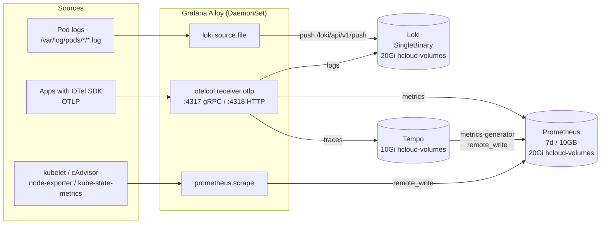
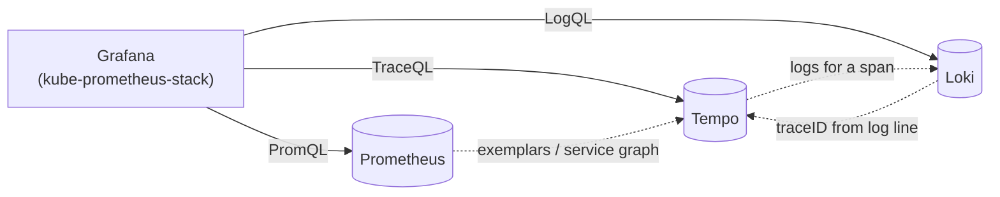

# Homelab Monitoring Plan

## Monitoring solution for kubernetes homelab

Proposed solution follow Grafana's promoted approach, based on **OpenTelemetry** + **Grafana Alloy**. For self-hosted on a small cluster, the best balance of simplicity/stability is:

| Area | Component | Notes |
| --- | --- | --- |
| **Metrics** | [`kube-prometheus-stack`](https://github.com/prometheus-community/helm-charts/tree/main/charts/kube-prometheus-stack) (Prometheus Operator + Prometheus + Alertmanager + Grafana) | Fastest start. Automatically collects K8s metrics, node-exporter, kube-state-metrics. Grafana is already included. |
| **Logs** | [`loki`](https://grafana.github.io/helm-charts) (in `single-binary` mode to start) | Lightweight for a homelab, indexes only labels, cheap on storage. |
| **Traces** | [`tempo`](https://grafana.github.io/helm-charts) | Sufficient to start (monolithic/minimal distributed). Accepts OTLP. |
| **Collector** | [`alloy`](https://grafana.github.io/helm-charts) (DaemonSet + optional Deployment) | Unified collector - collects pod logs, metrics (scrape/remote_write), traces (OTLP), enriches with K8s metadata. Replaces promtail/otel-collector in Grafana's new stack. |

## Architecture and data flow

### Write path (collection)



### Read path (query and correlation)



| Flow | Protocol | Endpoint |
| --- | --- | --- |
| Alloy -> Loki | HTTP push | `loki-gateway.monitoring.svc.cluster.local/loki/api/v1/push` |
| Alloy -> Prometheus | remote_write | `kube-prometheus-stack-prometheus.monitoring:9090/api/v1/write` |
| Alloy -> Tempo | OTLP gRPC | `tempo.monitoring.svc.cluster.local:4317` |
| Apps -> Alloy | OTLP gRPC/HTTP | `alloy.monitoring.svc:4317` / `:4318` |
| Grafana -> datasources | PromQL / LogQL / TraceQL | in-cluster services |

All traffic stays inside the cluster - nothing is exposed publicly except Grafana via Tailscale (see [Grafana Access](#grafana-access)).

## Repository structure

Stick to the current pattern (multi-source: chart + `$values` from this repo). Add separate files under `gitops/addons/` and values under `gitops/addons/values/`.

```text
gitops/
├── addons/
│   ├── monitoring-namespace.yaml      # monitoring namespace (optional, can be done via syncOptions)
│   ├── kube-prometheus-stack.yaml     # metrics + Grafana + Alertmanager
│   ├── loki.yaml                      # logs
│   ├── tempo.yaml                     # tracing
│   ├── alloy.yaml                     # collector (logs/metrics/traces)
│   └── values/
│       ├── kube-prometheus-stack.yaml
│       ├── loki.yaml
│       ├── tempo.yaml
│       ├── alloy.yaml
│       └── ... (existing)
└── root-app.yaml                      # unchanged (addons/ is already tracked)
```

## Proposed configuration for monitoring components


### `gitops/addons/values/monitoring/kube-prometheus-stack.yaml`

```yaml
# Minimal values for a homelab
grafana:
  enabled: true
  adminUser: admin
  # better to keep the password in a SealedSecret/ExternalSecret later
  adminPassword: "changeme-please"  # change after the first login
  service:
    type: ClusterIP
  persistence:
    enabled: false  # to start, can enable PVC
  sidecar:
    dashboards:
      enabled: true
      searchNamespace: ALL
    datasources:
      enabled: true
      defaultDatasourceEnabled: true

prometheus:
  prometheusSpec:
    retention: 7d
    retentionSize: "10GB"
    resources:
      requests:
        memory: 512Mi
        cpu: 250m
      limits:
        memory: 1Gi
        cpu: 500m
    storageSpec:
      volumeClaimTemplate:
        spec:
          storageClassName: local-path  # or hcloud-volumes
          accessModes: ["ReadWriteOnce"]
          resources:
            requests:
              storage: 20Gi

alertmanager:
  enabled: true
  alertmanagerSpec:
    storage:
      volumeClaimTemplate:
        spec:
          storageClassName: local-path
          accessModes: ["ReadWriteOnce"]
          resources:
            requests:
              storage: 2Gi

nodeExporter:
  enabled: true

kubeStateMetrics:
  enabled: true

# For K3s some scrapes are often unnecessary, the stack still works
defaultRules:
  create: true
```

### `gitops/addons/values/monitoring/loki.yaml`

```yaml
deploymentMode: SingleBinary

loki:
  auth_enabled: false
  commonConfig:
    replication_factor: 1
  storage:
    type: filesystem
  schemaConfig:
    configs:
      - from: "2024-04-01"
        store: tsdb
        object_store: filesystem
        schema: v13
        index:
          prefix: loki_index_
          period: 24h
  rulerConfig:
    storage:
      type: local

singleBinary:
  replicas: 1
  persistence:
    enabled: true
    storageClass: local-path
    size: 20Gi
  resources:
    requests:
      memory: 256Mi
      cpu: 100m
    limits:
      memory: 512Mi
      cpu: 250m

# Disable components that are unnecessary in single-binary
read:
  replicas: 0
write:
  replicas: 0
backend:
  replicas: 0

monitoring:
  selfMonitoring:
    enabled: false
  lokiCanary:
    enabled: false

test:
  enabled: false
```

###  `gitops/addons/values/monitoring/tempo.yaml`

```yaml
tempo:
  metricsGenerator:
    enabled: true
    remoteWriteUrl: "http://kube-prometheus-stack-prometheus.monitoring:9090/api/v1/write"

  storage:
    trace:
      backend: local
      local:
        path: /var/tempo/traces
      wal:
        path: /var/tempo/wal

  receivers:
    otlp:
      protocols:
        grpc:
          endpoint: 0.0.0.0:4317
        http:
          endpoint: 0.0.0.0:4318
    jaeger:
      protocols:
        thrift_http:
          endpoint: 0.0.0.0:14268
    zipkin:
      endpoint: 0.0.0.0:9411

persistence:
  enabled: true
  storageClassName: local-path
  size: 10Gi

resources:
  requests:
    memory: 256Mi
    cpu: 100m
  limits:
    memory: 512Mi
    cpu: 250m

serviceMonitor:
  enabled: true
```

### `gitops/addons/values/monitoring/alloy.yaml`

```yaml
alloy:
  configMap:
    create: true
    content: |-
      // Discovery
      discovery.kubernetes "pods" {
        role = "pod"
      }

      discovery.kubernetes "nodes" {
        role = "node"
      }

      // Pod logs -> Loki
      discovery.relabel "pod_logs" {
        targets = discovery.kubernetes.pods.targets
        rule {
          source_labels = ["__meta_kubernetes_namespace"]
          action = "replace"
          target_label = "namespace"
        }
        rule {
          source_labels = ["__meta_kubernetes_pod_name"]
          action = "replace"
          target_label = "pod"
        }
        rule {
          source_labels = ["__meta_kubernetes_pod_container_name"]
          action = "replace"
          target_label = "container"
        }
        rule {
          source_labels = ["__meta_kubernetes_pod_node_name"]
          action = "replace"
          target_label = "node"
        }
        rule {
          source_labels = ["__meta_kubernetes_namespace", "__meta_kubernetes_pod_name"]
          action = "replace"
          target_label = "job"
          separator = "/"
          replacement = "$1"
        }
        rule {
          source_labels = ["__meta_kubernetes_pod_uid", "__meta_kubernetes_pod_container_name"]
          action = "replace"
          target_label = "__path__"
          separator = "/"
          replacement = "/var/log/pods/*$1/*.log"
        }
      }

      local.file_match "pod_logs" {
        path_targets = discovery.relabel.pod_logs.output
      }

      loki.source.file "pod_logs" {
        targets    = local.file_match.pod_logs.targets
        forward_to = [loki.write.loki.receiver]
      }

      loki.write "loki" {
        endpoint {
          url = "http://loki-gateway.monitoring.svc.cluster.local/loki/api/v1/push"
        }
      }

      // OTLP for traces/metrics/logs from apps
      otelcol.receiver.otlp "default" {
        grpc { endpoint = "0.0.0.0:4317" }
        http { endpoint = "0.0.0.0:4318" }
        output {
          traces  = [otelcol.exporter.otlp.tempo.input]
          metrics = [otelcol.exporter.prometheus.default.input]
          logs    = [otelcol.exporter.loki.default.input]
        }
      }

      otelcol.exporter.otlp "tempo" {
        client {
          endpoint = "tempo.monitoring.svc.cluster.local:4317"
          tls {
            insecure = true
          }
        }
      }

      otelcol.exporter.prometheus "default" {
        forward_to = [prometheus.remote_write.prom.receiver]
      }

      otelcol.exporter.loki "default" {
        forward_to = [loki.write.loki.receiver]
      }

      prometheus.remote_write "prom" {
        endpoint {
          url = "http://kube-prometheus-stack-prometheus.monitoring:9090/api/v1/write"
        }
      }

  clustering:
    enabled: false

  resources:
    requests:
      memory: 128Mi
      cpu: 100m
    limits:
      memory: 256Mi
      cpu: 200m

controller:
  type: daemonset
  tolerations:
    - operator: Exists

serviceMonitor:
  enabled: true
```

> Note: depending on the Loki chart version, the service may be `loki` or `loki-gateway`. Check after deployment (`kubectl get svc -n monitoring`). The above assumes `loki-gateway`, which often appears in newer chart versions.

## ArgoCD Applications resources

### `gitops/addons/kube-prometheus-stack.yaml`

```yaml
apiVersion: argoproj.io/v1alpha1
kind: Application
metadata:
  name: kube-prometheus-stack
  namespace: argocd
  annotations:
    argocd.argoproj.io/sync-wave: "5"
  finalizers:
    - resources-finalizer.argocd.argoproj.io
spec:
  project: default
  sources:
    - repoURL: https://prometheus-community.github.io/helm-charts
      chart: kube-prometheus-stack
      targetRevision: 77.14.0  # check the current stable version before apply
      helm:
        releaseName: kube-prometheus-stack
        valueFiles:
          - $values/gitops/addons/values/monitoring/kube-prometheus-stack.yaml
    - repoURL: https://github.com/pawel150199/kubernetes-homelab.git
      targetRevision: master
      ref: values
  destination:
    server: https://kubernetes.default.svc
    namespace: monitoring
  syncPolicy:
    automated:
      enabled: true
      prune: true
      selfHeal: true
    syncOptions:
      - CreateNamespace=true
      - ServerSideApply=true
  revisionHistoryLimit: 5
```

### `gitops/addons/loki.yaml`

```yaml
apiVersion: argoproj.io/v1alpha1
kind: Application
metadata:
  name: loki
  namespace: argocd
  annotations:
    argocd.argoproj.io/sync-wave: "6"
  finalizers:
    - resources-finalizer.argocd.argoproj.io
spec:
  project: default
  sources:
    - repoURL: https://grafana.github.io/helm-charts
      chart: loki
      targetRevision: 6.46.0  # check the current version
      helm:
        releaseName: loki
        valueFiles:
          - $values/gitops/addons/values/monitoring/loki.yaml
    - repoURL: https://github.com/pawel150199/kubernetes-homelab.git
      targetRevision: master
      ref: values
  destination:
    server: https://kubernetes.default.svc
    namespace: monitoring
  syncPolicy:
    automated:
      enabled: true
      prune: true
      selfHeal: true
    syncOptions:
      - CreateNamespace=true
      - ServerSideApply=true
  revisionHistoryLimit: 5
```

### `gitops/addons/tempo.yaml`

```yaml
apiVersion: argoproj.io/v1alpha1
kind: Application
metadata:
  name: tempo
  namespace: argocd
  annotations:
    argocd.argoproj.io/sync-wave: "6"
  finalizers:
    - resources-finalizer.argocd.argoproj.io
spec:
  project: default
  sources:
    - repoURL: https://grafana.github.io/helm-charts
      chart: tempo
      targetRevision: 1.24.4  # check the current version
      helm:
        releaseName: tempo
        valueFiles:
          - $values/gitops/addons/values/monitoring/tempo.yaml
    - repoURL: https://github.com/pawel150199/kubernetes-homelab.git
      targetRevision: master
      ref: values
  destination:
    server: https://kubernetes.default.svc
    namespace: monitoring
  syncPolicy:
    automated:
      enabled: true
      prune: true
      selfHeal: true
    syncOptions:
      - CreateNamespace=true
      - ServerSideApply=true
  revisionHistoryLimit: 5
```

### `gitops/addons/alloy.yaml`

```yaml
apiVersion: argoproj.io/v1alpha1
kind: Application
metadata:
  name: alloy
  namespace: argocd
  annotations:
    argocd.argoproj.io/sync-wave: "7"
  finalizers:
    - resources-finalizer.argocd.argoproj.io
spec:
  project: default
  sources:
    - repoURL: https://grafana.github.io/helm-charts
      chart: alloy
      targetRevision: 1.14.3  # check the current version
      helm:
        releaseName: alloy
        valueFiles:
          - $values/gitops/addons/values/monitoring/alloy.yaml
    - repoURL: https://github.com/pawel150199/kubernetes-homelab.git
      targetRevision: master
      ref: values
  destination:
    server: https://kubernetes.default.svc
    namespace: monitoring
  syncPolicy:
    automated:
      enabled: true
      prune: true
      selfHeal: true
    syncOptions:
      - CreateNamespace=true
      - ServerSideApply=true
  revisionHistoryLimit: 5
```

## Grafana Access

Grafana is an HTTP service on port 80. The `tailscale.com/expose` Service annotation creates an L3 proxy that
preserves ports, so it works for services that already serve TLS on the port clients use (for example
`argocd-server` on 443). For Grafana, use a Tailscale **Ingress** instead: it terminates TLS on 443 and proxies
HTTP to the Grafana Service on port 80.

```yaml
grafana:
  ingress:
    enabled: true
    ingressClassName: tailscale
    hosts:
      - grafana
    path: /
    tls:
      - hosts:
          - grafana
```

This requires **HTTPS Certificates** to be enabled for the tailnet (one-time setting):
<https://login.tailscale.com/admin/dns> → **HTTPS Certificates** → **Enable HTTPS**.

After sync, Grafana is available at `https://grafana.<tailnet>.ts.net` with a valid Tailscale-issued
certificate, for example `https://grafana.tail692efe.ts.net`.

Retrieve the generated admin password:

```sh
kubectl -n monitoring get secret kube-prometheus-stack-grafana \
  -o jsonpath='{.data.admin-password}' | base64 -d; echo
```

`grafana.service.annotations` is supported, but `tailscale.com/expose` is only suitable for Services that
already serve TLS on the exposed port. For HTTP backends, use the Ingress above.

##  Remarks

| Topic | Recommendation |
| --- | --- |
| **Storage** | To start, `local-path` is sufficient. You also have `hcloud-volumes` (RWO) - better for critical things (longer retention) if you want to survive the loss of a node. With long retention, Prometheus/Loki will quickly eat up space. |
| **Resources** | CX23 has ~4GB RAM. Set retention: Prometheus 5-7 days, Loki less (7 days) to start. Watch `kubectl top pods -n monitoring`. |
| **K3s specifics** | `metrics-server` is broken - fix it before deploying dashboards that rely heavily on it. Additionally, cAdvisor/kubelet are available through the API. |
| **Tailscale only** | You don't need to open 80/443 to the world. Tailscale exposure is enough. If you ever add a public ingress, remember that `80` is currently blocked in the module's firewall. |
| **Secrets** | `adminPassword` in plain YAML is OK to start, but it's worth deploying Sealed Secrets (mentioned in TODO) and keeping them encrypted in the repo. |
| **CRDs** | `kube-prometheus-stack` installs quite a few CRDs (PrometheusRule, ServiceMonitor). Use `ServerSideApply=true` in syncOptions (added above) to avoid problems with large CRDs. |
| **Alloy config** | The configuration above is minimal. If you also want to collect system logs/`/var/log/` in more detail, it can be extended. For pod logs the above is sufficient. |
| **NetworkPolicy** | None - not necessary on a homelab, but worth considering later. |
